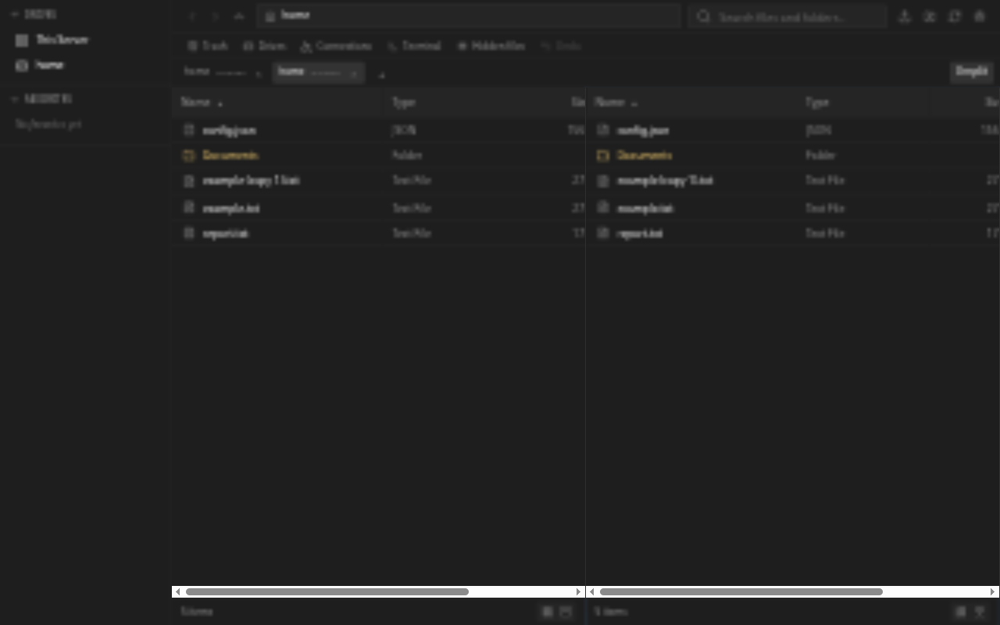
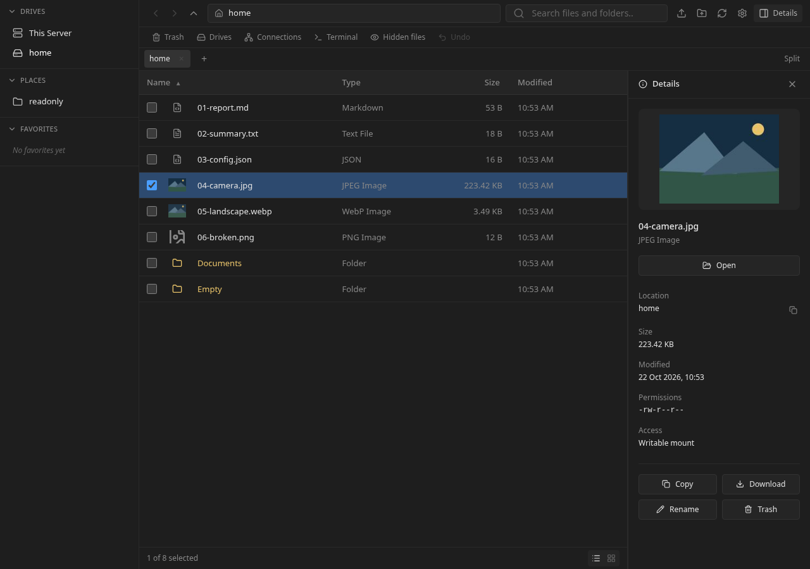
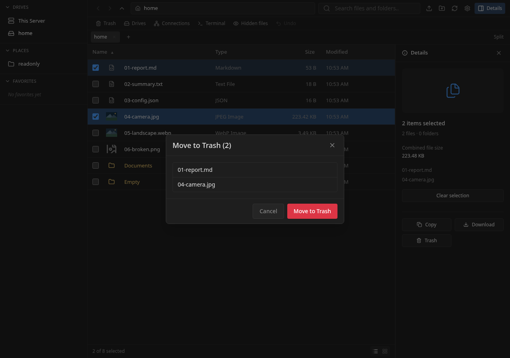
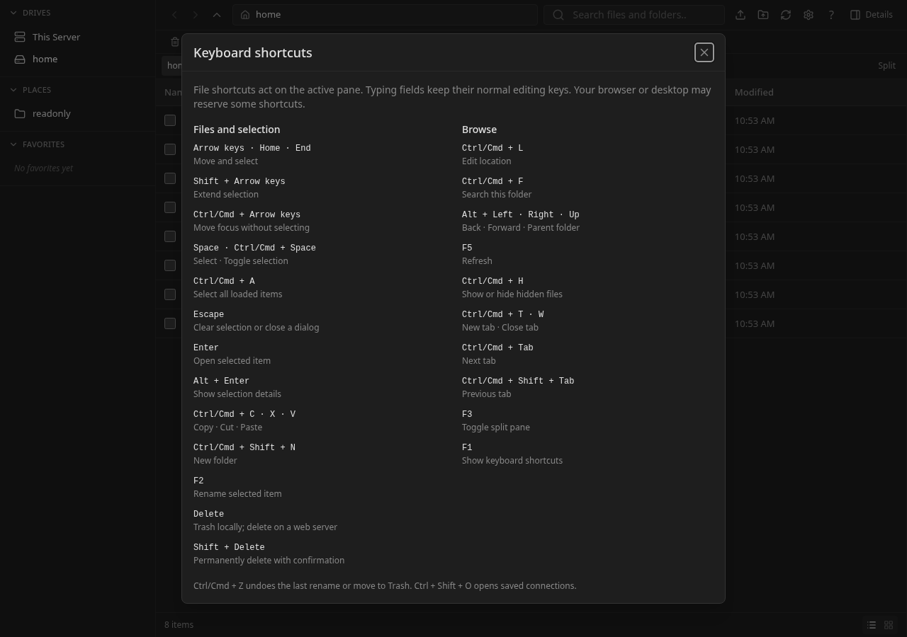

# Linux CEF desktop verification

Verified on Linux x64 with Bun 1.4.3. These results cover the CEF desktop and shared frontend/backend changes in this PR.

## Runtime evidence

The installed stable runtime passed `desktop/scripts/native-smoke.ts` in temporary XDG directories, without changing desktop associations:

```text
Native smoke passed: isolated runtime install, CEF folder launch, second-launch handoff without CEF, backend shutdown.
```

The test starts the real packaged executable with `--select`, waits for the requested folder's file-list request, checks that CEF started, and launches a second selection. It verifies that the second invocation exits successfully without starting CEF and that the existing process requests the second folder. Finally it verifies backend shutdown. This is native process and navigation evidence; it does not assert every rendered pixel or interaction.

`desktop/scripts/integration.ts` exercised the real private Go server and filesystem: Trash/restore, restore conflicts without overwrites, symlink preservation, names containing `..`, default opening, Open With through a fixture application, and volume listing. It also rejected an ambiguous percent-containing clipboard selection through HTTP before publishing it. The fixture opener records its input rather than opening a user application. Volume listing does not prove device mount or eject.

`desktop/scripts/smoke.ts` verified private bootstrap, embedded UI, mount confinement, foreign-Origin rejection, authenticated WebSocket upgrade, and server shutdown.

The browser fixture below shows two tabs and split panes. Clicking Split created two file-browser panes; opening another tab created an independent pane. This screenshot is browser layout evidence, separate from the installed CEF test.



## Shared browser polish

The production UI was exercised against an isolated temporary filesystem. List and grid checkboxes, a three-item Shift range, and Ctrl+A selected the expected files. Single-click selected a folder under the default double-click preference; double-click opened it. Switching the setting to single-click, saving, and reloading retained that preference and opened the folder with one click.

Details showed single-file metadata, a complete JPEG preview, combined file bytes for multiple selections, and no write actions on a read-only mount. JPEG and WebP thumbnails loaded; a deliberately invalid PNG fell back to its icon. The list fit beside Details without horizontal overflow. At a 390-pixel viewport, Details fit in a 320-pixel overlay with an accessible close button and no page overflow. The delete dialog showed the count only in its heading. Shift+Tab stayed inside it, Escape dismissed it, and focus returned to its initiating button. No fixture files were deleted by this dialog check.

The real authenticated web browser test passed login, default double-click activation, browser Back/Forward and toolbar history, search focus, sort, grid, preference persistence, settings, public shares, reload, and logout. Browser Back returned from the child folder to its parent. A launch URL selecting `.hidden.txt` revealed and selected that file with global hidden-file display disabled.

These interactions use the shared frontend in local desktop mode through a browser. The packaged native smoke below separately verifies CEF launch and navigation. Video/PDF thumbnails and real removable-drive actions remain outside this verification.





## Keyboard shortcuts

F1 and the toolbar's ? button open the in-app reference. Live production-browser checks passed Shift-arrow range selection in list and grid, Ctrl+Home focus movement without changing selection, and vertical movement across a responsive three-column grid. Alt+Enter opened Details; Ctrl+F focused Search; Ctrl+Shift+N opened New Folder from toolbar focus. Delete did not activate file deletion while Help or the folder-name input was open. Escape closed dialogs and cleared selection outside them. In split view, Ctrl+A selected eight loaded items in the active right pane while the left pane retained its one-item selection.

The authenticated browser workflow now covers keyboard selection, Details, Help, modal isolation, search focus and selection from toolbar focus. It waits for folder URL navigation and the visible Saved state before asserting history or preference persistence. These waits cover the existing asynchronous operations instead of navigating away while they are pending.



Lazy-chunk recovery timed out in the combined browser run; the standalone recovery run passed for grid, wallpaper and shared links. The final CEF package built and its native launch smoke passed. Physical keyboard delivery through CEF and host-reserved combinations were not exercised by that smoke; the interaction checks above used Chromium against the embedded production UI. No backend behavior changed in this follow-up.

## Automated checks

| Command | Result |
| --- | --- |
| `bun install --frozen-lockfile` | Passed; lockfile unchanged |
| `bun run check:desktop` | Passed |
| `bun run test:desktop` | 45 passed, 0 failed |
| `bun run --cwd frontend check` | 0 errors, 0 warnings |
| `bun run --cwd frontend lint` | Passed |
| `bun run --cwd frontend test` | 164 passed, 0 failed |
| `bun run --cwd frontend build` | Passed |
| `bun run --cwd frontend perf:budget` | 290760 bytes against the lowered 290816-byte ceiling |
| `bun run --cwd website build` | Passed |
| `bun run build:desktop` | Stable Linux CEF package built |
| `go vet ./...` in `backend/` | Passed |
| `go test ./...` in `backend/` | Passed after the clipboard fix |
| `go test -race ./...` in `backend/` | Passed, focused race checks repeated after the final Trash identity change |
| `git diff --check` | Passed |

## Reproduce the native and API checks

After installing the Linux prerequisites in [the desktop guide](../../../desktop/README.md), run these commands from the repository root in a graphical session:

```sh
bun install --frozen-lockfile
bun run build:desktop
bun run --cwd desktop scripts/integration.ts
bun run --cwd desktop scripts/smoke.ts
bun run --cwd desktop scripts/native-smoke.ts
```

## Limits

- The browser performance gate fails. The published starting head already exceeded its 9-script / 287,744-decoded-byte limits at 19 scripts / 317,752 bytes. Commit `0a3ba4d` measured 24 scripts / 328,009 bytes; the keyboard-shortcut follow-up has not rerun that journey benchmark. Experimental chunk changes made this worse or created import loops and were reverted. The limits were not raised. The static bundle gate is a separate measurement and does not make the browser journey pass.
- CI's website runner used Node 22.23.3, below Astro's supported minimum. The workflow now selects Node 24 explicitly. The local website build passed; the updated hosted job is pending.

- Docker image build was not run because the Docker daemon is unavailable.
- Real removable-device mount/unmount/eject, remote-server login, and macOS/Windows integration were not tested.
- Archive tools, bulk rename, permission editing, outbound native drag, and remote download-and-open are not implemented.
- Clipboard publication rejects paths containing `%`. Native clipboard imports reject paths that the shared virtual-path resolver would reinterpret as another file. A regression covers both siblings being present and cut cleanup after the original moves.
- No default handlers were changed, and no release was published.
