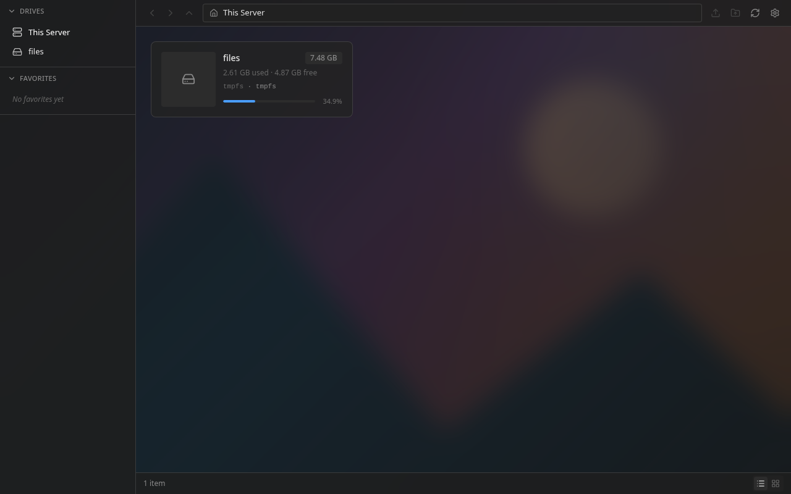
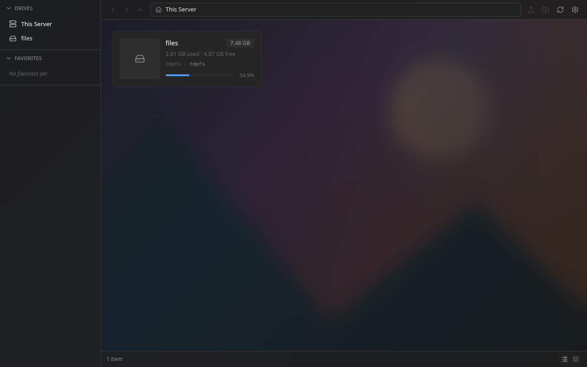
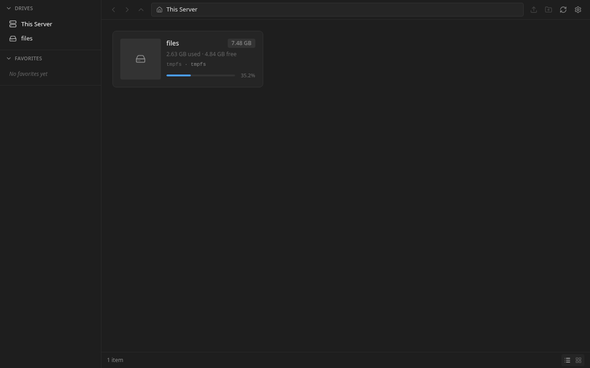

# Issue #181 verification

A fresh browser now restores the signed-in user's wallpaper from the server. Logging out clears active preferences, and another account loads its own browser preferences. The PR is based on `master` (`e400f8a`); unrelated desktop work from the initial checkout is excluded.

## Runtime evidence

Run: Chromium 156.0.8078.4, two isolated browser contexts, the real Go API and Svelte app, and two fixture accounts (`alice`, `bob`). The script uses the Settings UI to upload and save a generated PNG, then exercises login, reload, logout, and account switching.

[Machine-readable results](browser-results.json) include the observed wallpaper API requests and statuses. Assertions confirmed:

- Alice saved a local PNG through Settings. The server returned 200, and the workspace rendered the image with `contain` and frosted glass.
- A fresh browser context with empty localStorage and IndexedDB downloaded Alice's wallpaper. The SHA-256 of the downloaded image in real IndexedDB matched the uploaded PNG: `cffec9a529ff30775f49781487feb81eae639fe56805e8e1eddad458d1570742`.
- Reload restored the session, confirmed wallpaper metadata, and reused the cached image without another image download.
- Logout removed the rendered background. Bob then received 404 for his own wallpaper and saw a plain workspace.
- Alice signed back in to that shared browser and recovered her wallpaper and display settings.
- No uncaught browser page errors occurred.

### Alice on the first browser



### Alice in a fresh browser



### Bob using Alice's browser after logout



### Alice returning to the shared browser


## Regression and build checks

- `go vet ./...`: passed.
- `go test ./internal/handler -run Wallpaper -count=1`: passed, including the new authenticated image route, account isolation, missing/deleted images, MIME and cache headers.
- `go test -race ./internal/handler ./internal/service -run Wallpaper -count=1`: passed.
- `go test ./...`: failed twice in the unchanged `TestProperty_JobCompletionNotification`, once for a copy notification and once for a move notification. The isolated retry passed. [Failure and retry details](backend-suite-note.txt). No job service or job test code changed in this PR.
- `bun run test`: 124 passed, 0 failed across 15 files. New tests use HTTP requests and IndexedDB to cover restoration, cache confirmation, remote replacement/deletion, publication, account switching, expiry, delayed responses, legacy ownership, and failure handling.
- `bun run check`: 0 errors, 0 warnings.
- `bun run lint`: passed.
- `bun run build`: passed, with large-chunk warnings.
- `bun run perf:check`: passed.
- `bun run perf:budget`: 320,324 static JS bytes. The ceiling was lowered from 321,536 to 320,512 bytes. Restore and publish implementations load on demand.
- `bun scripts/auth-session-browser.ts`: passed overlapping refresh/shared-cookie recovery and logout.
- Svelte autofixer: no issues or suggestions in the changed stores.
- The browser verification script also passed a standalone TypeScript check.

The new route and fresh-login regression were run against the original implementations and failed as expected: the image route returned 404, and fresh login left `backgroundImage` null. See [backend failure](backend-before.txt) and [frontend failure](frontend-before.txt).

## Repeat the browser check

Use an isolated server with a writable fixture mount, two users named `alice` and `bob`, and password `wallpaper-test` for both. Serve this frontend with `/api` proxied to that server. The script resets both fixture accounts' server wallpapers before exercising the UI.

From `frontend/`:

```sh
BUN_RUNTIME_TRANSPILER_CACHE_PATH=0 BOXBOX_TEST_URL=http://127.0.0.1:5183 bun scripts/verify-wallpaper-sync.ts
```

The script saves screenshots and JSON to this directory. Set `BOXBOX_TEST_EVIDENCE` to choose a different output directory.

The fresh-browser check reads Alice's persisted wallpaper reference, verifies its account-owned ID, and hashes the blob at that exact IndexedDB key. See [the account-owned verification rerun](sync-verification-validation.txt) for the baseline failure and corrected result.

Not exercised: Firefox, Safari, a second physical computer, Docker, native desktop clients, and the complete browser/allocation performance comparison suites. Server-side wallpaper changes are covered by regression tests; multi-device live synchronization without a new login is outside this fix.
