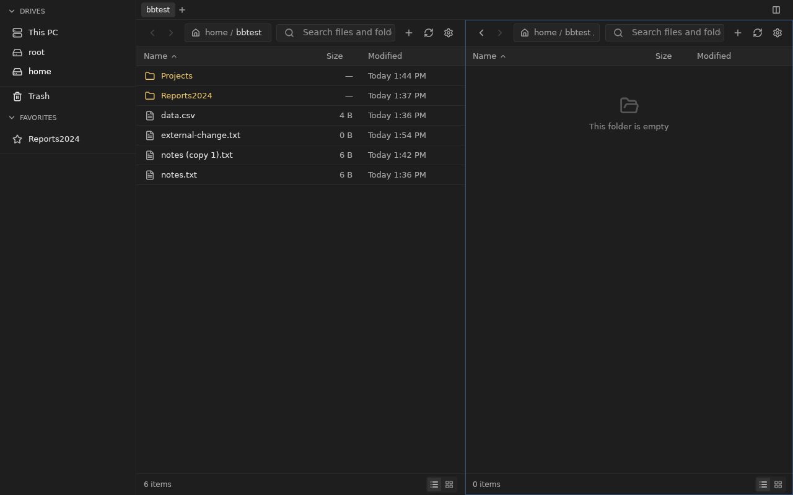
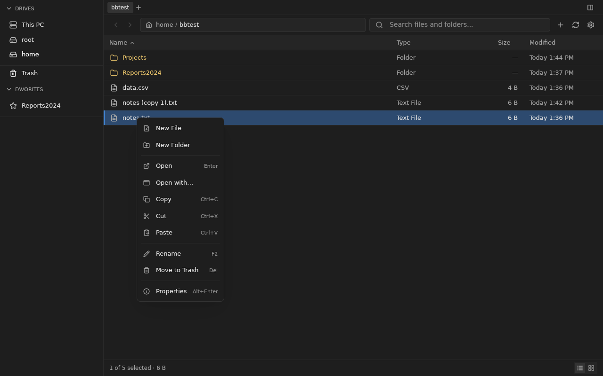
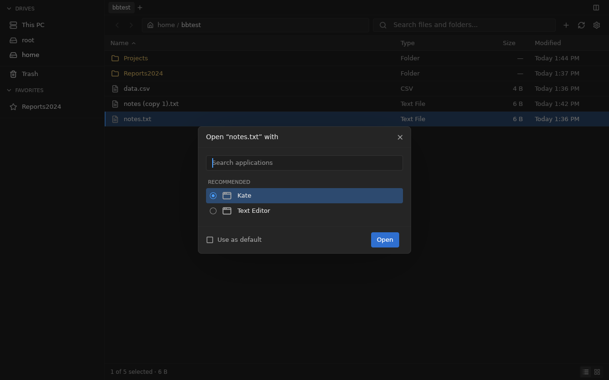
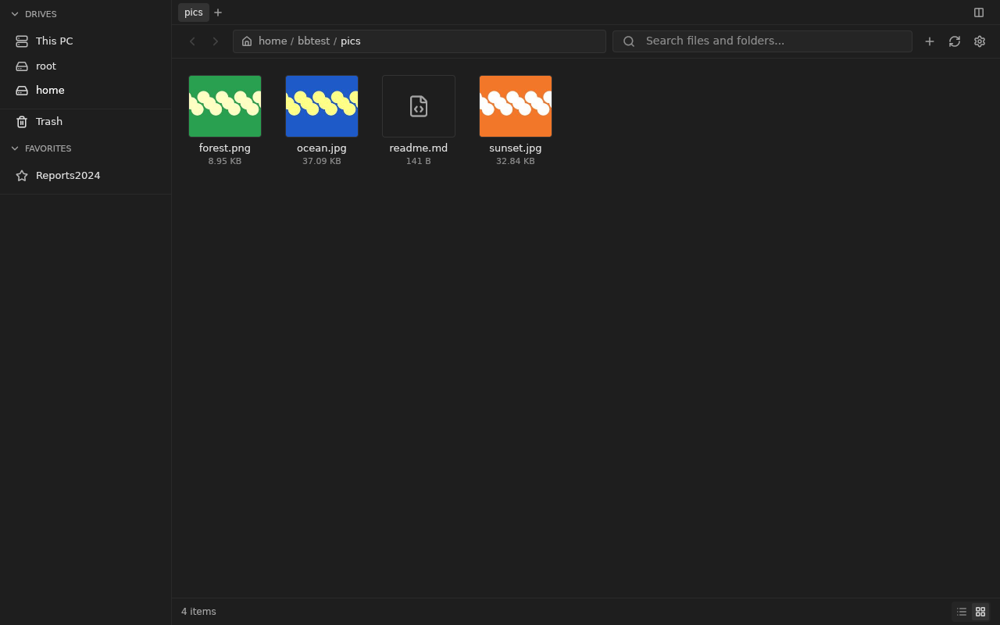
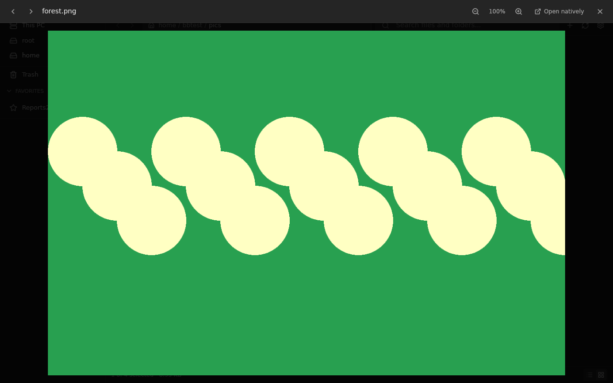
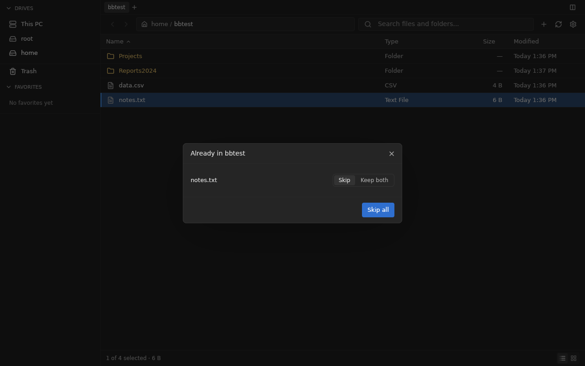
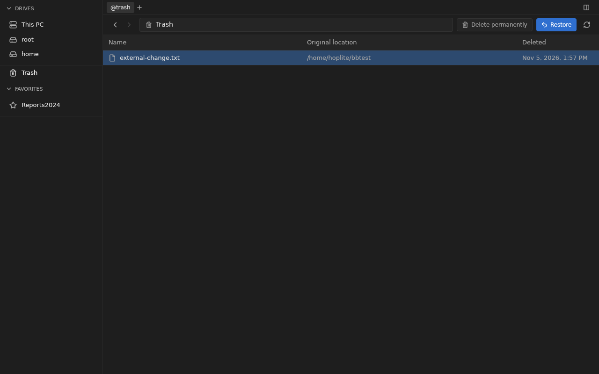
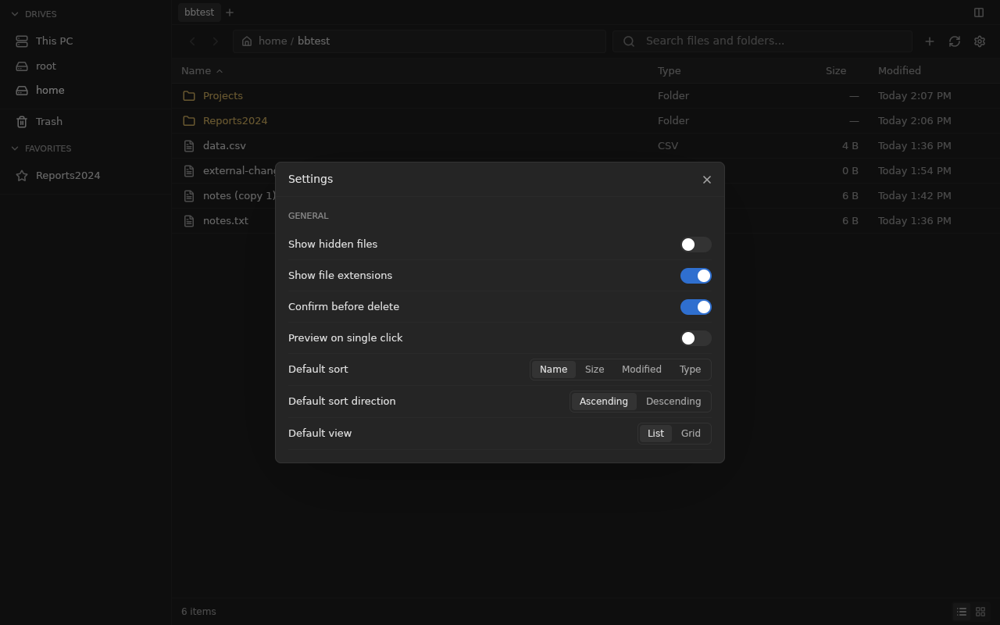

# BoxBox desktop client in Rust (GPUI)

A native Linux client for BoxBox built with [GPUI](https://gpui.rs) 0.2.2, Zed's GPU UI framework. It reproduces the Electrobun desktop app (`desktop/`) and the shared Svelte UI, and drives the same bundled Go server over the same `/api/v1` and `/api/v1/desktop` endpoints. It is an alternative client and does not replace `desktop/`.

[`BENCHMARKS.md`](BENCHMARKS.md) compares it with the Electrobun app. With the same server and a 10,000-entry folder, the GPUI client opened its window 5.4× faster and settled the folder 2.1× faster. It used 98 MiB of memory against 577 MiB, used about a ninth of the idle CPU, and is about 15× smaller installed.

## Features

| Area | What works | Source it mirrors |
| --- | --- | --- |
| Runtime | Starts the private `boxbox --desktop` server with a random token, desktop mounts and loopback readiness, and authenticates with the `boxbox_desktop` cookie. The server stops with the last window. Single instance: a later launch opens its path as a tab in the running window. | `desktop/src/server.ts`, `instance.ts` |
| Browsing | Drives and places, This PC drive cards and list, breadcrumbs, an editable location bar (Ctrl+L, BoxBox or absolute paths), back, forward and up, tabs, split panes (F3), list and grid views, sortable columns, and click, Ctrl and Shift selection | `BrowseWorkspace.svelte`, `Toolbar.svelte`, `EditablePathBar.svelte`, `FileList.svelte`, `FileGrid.svelte` |
| Sorting | PR #211's order: folders first, newest modified first, then natural names, then paths. Saved and explicit sorts still apply. | `browse/sortFiles.ts` (PR #211) |
| Search and refresh | Recursive name search, active from two characters with a 300 ms debounce. Folders refresh live from the desktop watch stream and fall back to a 15 s poll. | `SearchBar.svelte`, `browse/desktopWatch.ts` |
| File operations | New file or folder, rename, Move to Trash, permanent delete, and properties, using the same dialogs. Undo (Ctrl+Z) covers rename and Trash. | `BrowseDialogs.svelte`, `browse/undo.svelte.ts` |
| Clipboard and transfers | Copy, cut and paste through the OS clipboard (`/desktop/clipboard`), so files copied in other apps paste here. Conflicts offer Skip or Keep both (`name (copy N).ext`). Background jobs show live progress over SSE, can be cancelled, and clear a cut once it completes. | `paste.svelte.ts`, `transfers.ts`, `TransferJobs.svelte` |
| Drag and drop | Drop onto folders, the other pane or sidebar places. Items move, or copy with Ctrl held. Files dropped from other apps are copied. Items can be dragged out to other apps on X11. | `browse/fileDrag.ts`, `fileDrop.ts` |
| Context menus | File, empty-space and drive menus with the same items, shortcuts and disabled states | `utils/fileContextMenu.ts`, `DriveContextMenu.svelte` |
| Desktop integration | Open with the default app, Open With with app icons and a "Use as default" checkbox (PR #211), Open in Terminal, favorites, removable volumes (mount, unmount, eject) and the Trash page (restore, two-step permanent delete) | `OpenWithDialog.svelte`, `TrashPage.svelte`, `Sidebar.svelte` |
| Previews | Grid thumbnails from the server. A preview overlay for images (with zoom), text and code, and a PDF's first page, with ←/→ to step through files. Video, audio, office files and notebooks show their details with "Open natively". | `FileThumbnail.svelte`, `FilePreview.svelte` |
| Settings | Hidden files, file extensions, confirm before delete, preview on single click, and default sort, direction and view. They are saved to the same `/desktop/preferences` file as the Electrobun app, and keys this client doesn't use are kept. | `settings/GeneralSettings.svelte` |
| Keyboard | The Electrobun shortcut set and the F1 shortcuts dialog | `KeyboardShortcutsDialog.svelte` |

### Not ported yet

- **Remote servers:** pairing and Settings → Connections, remote browsing and cross-server transfers (`/desktop/servers/*`, `/desktop/transfers`).
- **PR #211's file chooser portal:** the D-Bus backend, the picker window and `/desktop/chooser/*`. PR #211's Open With changes and default sort are ported.
- **Appearance settings:** wallpaper, accent colour, wallpaper tint, frosted glass, compact mode, selection checkboxes, drive renames and the hardware-acceleration toggle. The client uses the default dark theme.
- **Previews:** editing text and saving with Ctrl+S, media playback, rendered office documents and notebooks, and multi-page PDFs. GPUI has no media or PDF engine; these open in the native app instead.
- **Keyboard:** arrow-key focus movement, type-ahead, and opening the context menu with the Menu key or Shift+F10.
- **Other:** dragging out on Wayland, packaging (a desktop entry, AppImage or installer), and macOS and Windows.

### Dragging files to other apps

Drag a row or tile out of the window to drop it into another app. GPUI 0.2 only receives external drops, so `src/drag_out/` implements an XDND v5 drag source itself, offering `text/uri-list` with the copy action. The items are downloaded to `$TMPDIR/boxbox-gpui-drag/` once the pointer reaches another app's window, and folders arrive as ZIP archives. This works only under X11. Under Wayland, start the app with `WAYLAND_DISPLAY=` to use XWayland.

## Screenshots

| | |
| --- | --- |
|  |  |
|  |  |
|  |  |
|  |  |
|  |  |

`screenshots/web-grid-reference.png` is the web app's grid view for comparison.

## Run

Like the Electrobun app, the client starts its own private BoxBox server. It writes a fresh config that mounts `/`, your home folder, and whichever standard home folders exist (Desktop, Downloads, Documents, Music, Pictures, Videos). It then launches `boxbox --desktop` with a random 64-character token and waits for the server to report its loopback address. Requests carry the token as the `boxbox_desktop` cookie. The server keeps its data in `$XDG_DATA_HOME/boxbox-gpui` and stops when the last window closes.

The server binary is looked up next to the executable. `BOXBOX_SERVER_BIN` overrides that path during development:

```sh
go build -C backend -o ../dist/boxbox ./cmd/server
cd experiments/gpui-desktop
BOXBOX_SERVER_BIN=../../dist/boxbox cargo run --release
```

To attach to a server that is already running, set `BOXBOX_URL` instead, and `BOXBOX_TOKEN` if that server needs a bearer token. An optional argument opens a path such as `media/movies`.

On Linux, GPUI needs Vulkan and the development packages for xkbcommon, wayland, X11/xcb, fontconfig and freetype. On Debian/Ubuntu, install them with:

`sudo apt install libxkbcommon-dev libxkbcommon-x11-dev libwayland-dev libvulkan1 libx11-xcb-dev libxcb1-dev libfontconfig-dev libfreetype-dev`

## Tests

```sh
cargo test
```

These cover the logic ported from the frontend and desktop app: API parsing and path encoding, sorting (including PR #211's order), formatting, selection and history, paste planning and "Keep both" names, drop rules, context-menu items, Open With choices, preferences round-trips, the job progress labels, SSE parsing, the server readiness check, location parsing and single-instance forwarding.

## Regenerating icons

```sh
bun install --cwd frontend
bun run experiments/gpui-desktop/scripts/extract-icons.ts
```

Add the icon name to `ICONS` in the script and to the `icons!` list in `src/assets.rs`.
