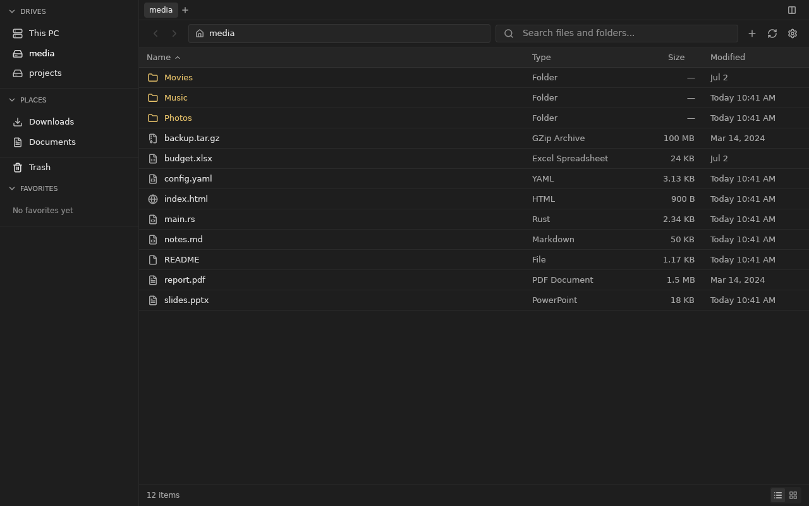
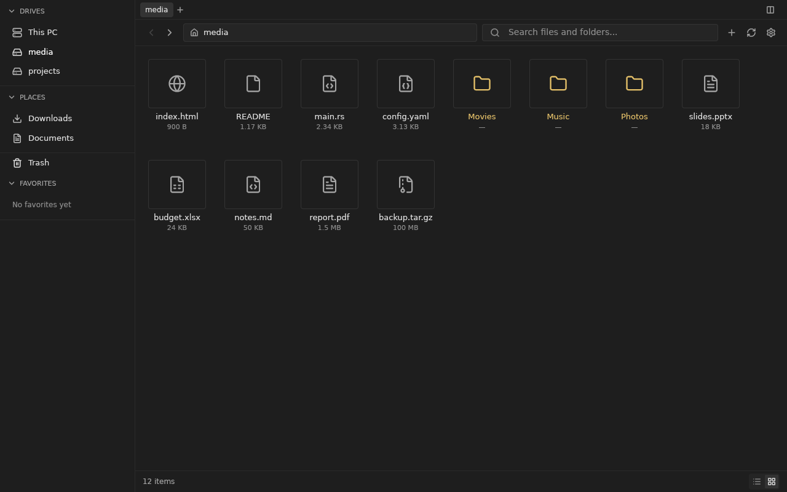
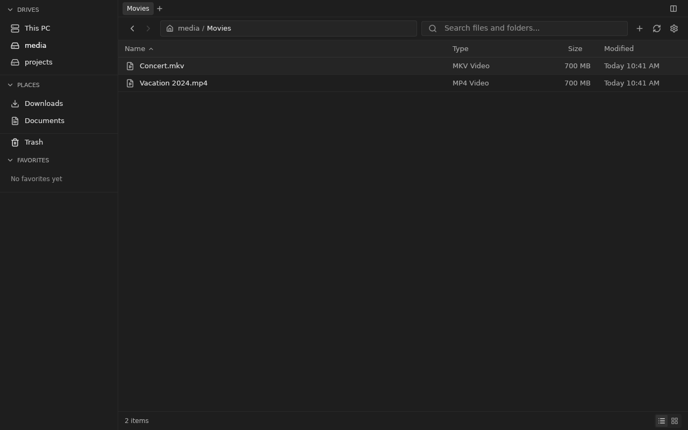
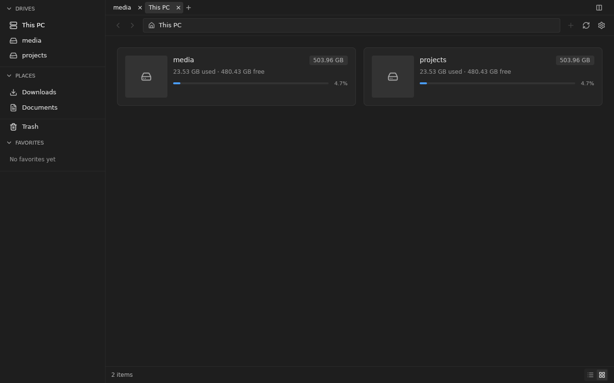

# BoxBox GPUI desktop (experiment)

A native Rust rebuild of the BoxBox desktop browse UI with [GPUI](https://gpui.rs) 0.2.2. Local files use Rust directly; remote connections use the Go server's `/api/v1` endpoints. The recreation is unfinished and does not replace `desktop/`.

## What it reproduces

| Svelte source | GPUI module |
| --- | --- |
| `routes/layout.css` tokens | `src/theme.rs` |
| `Sidebar.svelte` (Drives, Places, Trash, Favorites) | `src/ui/sidebar.rs` |
| `desktop/BrowseWorkspace.svelte` tab strip | `src/ui/tabs.rs` |
| `Toolbar.svelte`, `EditablePathBar.svelte`, compact `SearchBar.svelte` | `src/ui/toolbar.rs` |
| `FileList.svelte` | `src/ui/file_list.rs` |
| `FileGrid.svelte` | `src/ui/file_grid.rs` |
| `DriveCard.svelte`, `DriveList.svelte` | `src/ui/drives.rs` |
| `StatusBar.svelte` | `src/ui/status_bar.rs` |
| `utils/format.ts`, `utils/fileTypes.ts`, `browse/sortFiles.ts` | `src/format.rs`, `src/sort.rs` |

Icons are the frontend's own Lucide glyphs, extracted from `frontend/node_modules/lucide-svelte` into `assets/icons/` by `scripts/extract-icons.ts`. Fonts resolve through fontconfig, as the browser resolves the CSS `sans-serif` and `monospace` stacks.

Browse behavior includes drive/folder navigation, history, breadcrumbs, tabs, list/grid views, sorting, selection, refresh, search and settings. A rendered GPUI workflow verifies local and remote create/edit/rename/copy/delete, local Trash restore, folder favorites, remote share creation/revocation and wallpaper persistence. Both split panes render. Native chooser interaction, full preview/transfer behavior and exact visual parity remain open; see [the parity ledger](surface-ledger.md).

### Dragging files to other apps

Drag a row or tile out of the window to drop it into another app, such as a file manager, browser, or editor. Dragging a selected item carries the whole selection. GPUI 0.2 can only receive drops from other apps, so `src/drag_out/` implements the X11 drag-and-drop protocol (XDND v5) itself, offering the files as `text/uri-list` with the copy action.

Local files are handed to other apps by their real filesystem paths. Remote files are staged into `$TMPDIR/boxbox-gpui-drag/`. Folders arrive as the server's ZIP archive. The staged copies are not deleted automatically.

This only works on X11. On Niri, the app prefers XWayland when DISPLAY exists because the native Wayland renderer retained stale frames on the development host. `BOXBOX_NATIVE_WAYLAND=1` opts back into native Wayland. On other compositors, start with `WAYLAND_DISPLAY=` to select XWayland. macOS and Windows are not implemented. The existing Electrobun app cannot drag files out either.

The current GPUI build still lacks the private `--desktop` cookie/session behavior and a full Rust replacement for the Go self-hosted server. Search matches every word of the query against file names below the open folder, ranks the best matches first, and shows local results while it is still walking. Settings opens as a native modal and persists browse preferences. Native thumbnails use the existing Rust renderer. The surface ledger records runtime evidence and remaining direct-interaction checks.

### Devices and network locations

The sidebar lists disks from UDisks2, and phones and network shares from GVfs, both over D-Bus. A row shows how full a mounted volume is, a mark when it is read-only, and is dimmed while unmounted; an encrypted volume shows a lock and asks for its passphrase. Type `smb://server/share`, `sftp://user@host/path` or `ftp://host` in the location bar (Ctrl+L) to mount and open a network location. Network backends are GVfs packages: `gvfs-smb` for SMB, `gvfs-mtp` for phones.

## Screenshots

| List | Grid |
| --- | --- |
|  |  |
|  |  |

`screenshots/web-grid-reference.png` is the web app's grid view for comparison.

## Run

With no `BOXBOX_URL`, GPUI opens local files directly in Rust. Set `BOXBOX_ROOT` to use an isolated local root for a fixture. To connect to a self-hosted server, set `BOXBOX_URL`; set `BOXBOX_TOKEN` when the server requires a bearer token.

```sh
cd experiments/gpui-desktop
cargo run --release
BOXBOX_ROOT=/tmp/boxbox-fixture cargo run --release home
BOXBOX_URL=http://127.0.0.1:8080 BOXBOX_TOKEN=... cargo run --release media/movies
```

On Linux, GPUI needs Vulkan and the development packages for xkbcommon, wayland, X11/xcb, fontconfig and freetype. On Debian/Ubuntu, install them with:

`sudo apt install libxkbcommon-dev libxkbcommon-x11-dev libwayland-dev libvulkan1 libx11-xcb-dev libxcb1-dev libfontconfig-dev libfreetype-dev`

## Benchmark snapshot

Measured locally on Linux on 2026-11-05, using the same BoxBox server workload and a warm installed desktop runtime. Startup is measured from process launch until the first browse API/page-ready event; memory is settled RSS after approximately three seconds.

| Runtime | Startup | Settled RSS | Notes |
| --- | ---: | ---: | --- |
| GPUI | 177 ms | 113 MB | Native GPUI window plus bundled server |
| MyGo/WebKitGTK | 303 ms | 227 MB | MyGo host, WebKitGTK and private server |
| Electrobun/CEF | 413 ms | 705 MB | Production baseline, CEF helper process tree |

Against the Electrobun baseline, GPUI was approximately 57% faster to first browse request and used 84% less settled memory. These are local point-in-time measurements, not a release performance guarantee; repeat them on the target hardware before making a shipping decision. The benchmark infographic is available as a T3 Canvas artifact in the development workspace.

## Tests

```sh
cargo test
```

These test formatting, sorting, selection/history and a rendered GPUI filesystem workflow. The workflow automatically isolates its settings:

```sh
cargo test
# Build backend/cmd/server first, then run the same controls over HTTP:
BOXBOX_PARITY_SERVER=/absolute/path/to/server cargo test desktop_workflow
```

The workflow uses a temporary filesystem and, in remote mode, its own loopback Go process. The GPUI test platform cannot open a native file chooser, so wallpaper installation is invoked directly and subsequent settings controls are clicked.

## Regenerating icons

```sh
bun install --cwd frontend
bun run experiments/gpui-desktop/scripts/extract-icons.ts
```

Add the icon name to `ICONS` in the script and to the `icons!` list in `src/assets.rs`.
